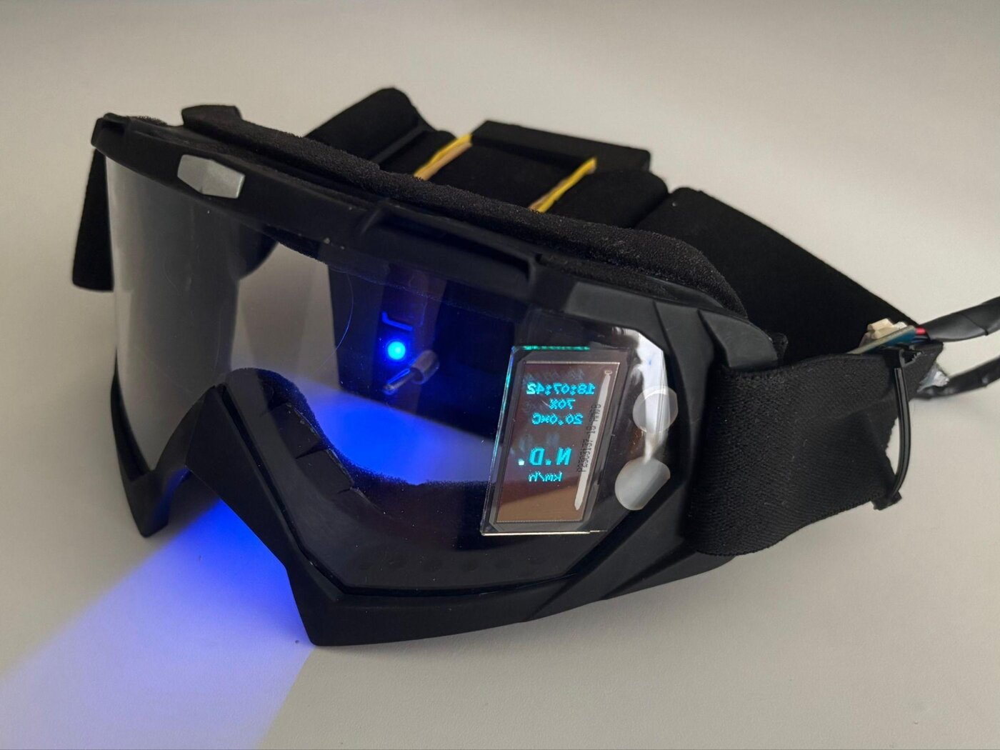
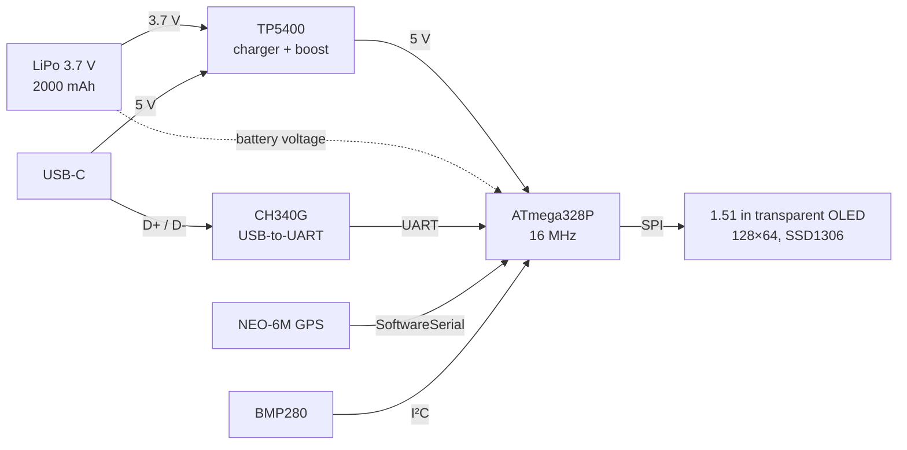
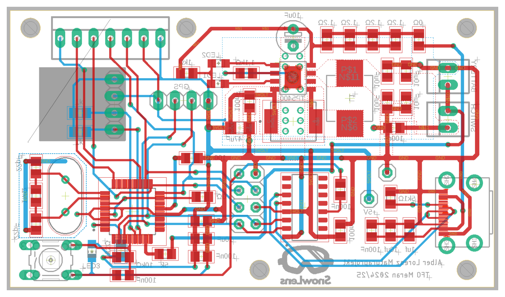
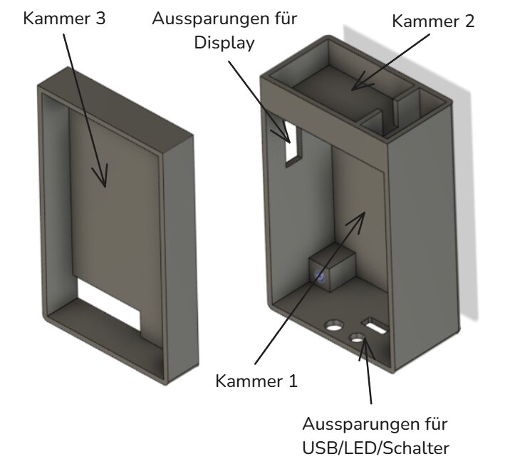
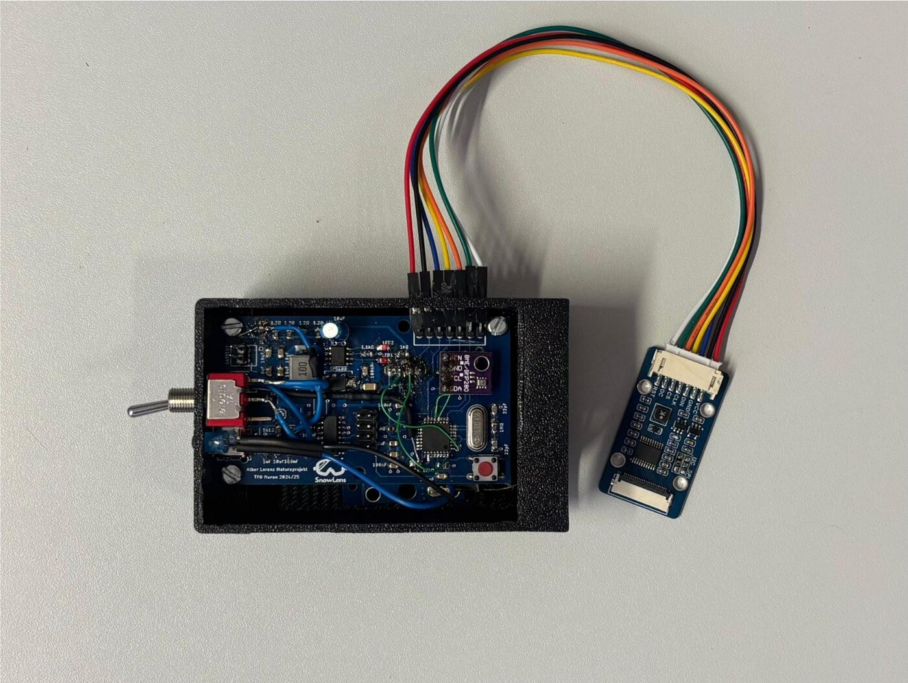
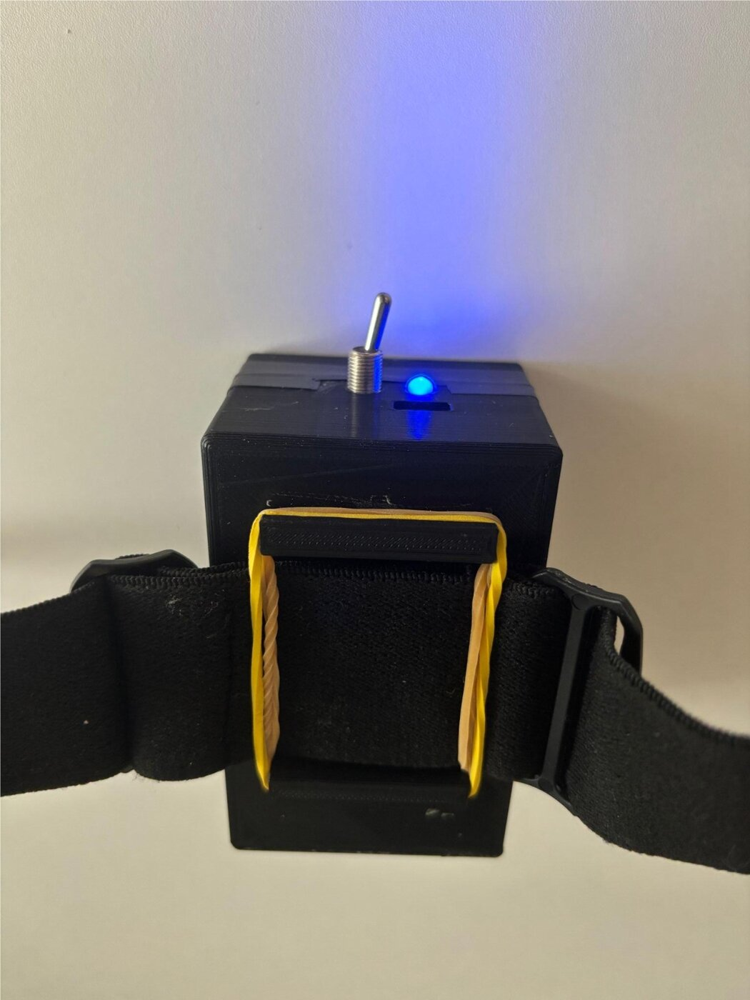
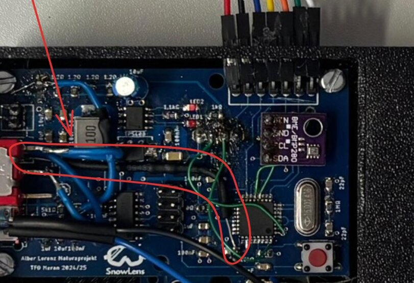

# SnowLens – DIY Head-Up Display for Ski Goggles

A ski goggle with a built-in transparent OLED that shows **speed, time, temperature and battery level** in real time while skiing.
Designed and built from scratch (schematic, PCB, firmware and enclosure) as my final-year project (*Maturaprojekt*) at TFO "Oskar von Miller" Meran, school year 2024/25.

<p align="center">
  
</p>

## Motivation

To see your top speed while skiing you usually need a tracker app on your phone, and you can only look at it at the end of the day. Commercial goggles with a head-up display start at around 400 €.
The idea came from Iron Man's helmet HUD: could a cheap, self-built version show the most important data right in front of my eyes?

## Features

- **Speed** in km/h from GPS (shows `N.D.` until there is a valid fix)
- **Time** from the GPS signal (UTC + 2 h, Italian summer time)
- **Ambient temperature**
- **Battery level** in percent
- 2000 mAh LiPo, **rechargeable via USB-C**, designed to last a full ski day
- **Programmable over the same USB-C port** (CH340 USB-to-serial, auto-reset)
- 3D-printed electronics box that clips onto the goggle strap

## System Overview



| Component | Part | Why |
|---|---|---|
| Microcontroller | ATmega328P-AU | Well known from Arduino, low power, enough for the job (ESP32 was considered, but Wi-Fi/BT not needed) |
| GPS | GY-NEO6MV2 (u-blox NEO-6M) | Cheap, NMEA over UART, backup battery for a faster fix |
| Temperature | BMP280 breakout | ±1 °C, −40…+85 °C, works on 5 V I²C |
| Display | Waveshare 1.51" transparent OLED | See-through, thin, SPI |
| Power | TP5400 | LiPo charger and 3.7 V → 5 V boost converter in one IC |
| USB | CH340G + USB-C | Charging and programming through one connector |

**Power budget:** about 117 mA in total (MCU ≈ 15 mA, display ≈ 35 mA, GPS ≈ 65 mA, sensor ≈ 2 mA). Assuming double the consumption in the cold (≈ 234 mA), the 2000 mAh battery gives roughly 8 hours of runtime.

## Hardware

<p align="center">
  
</p>

- Two-layer PCB, mostly 0805 SMD parts, manufactured by JLCPCB and hand-soldered
- Ground plane on the bottom layer, 5 V plane on the top layer
- 16 MHz crystal and decoupling capacitors placed as close to the MCU as possible
- Pin headers for GPS, sensor, display and the bootloader (ISP) connector

Schematic and layout: [`hardware/SnowLens_Schematic_and_Board.pdf`](hardware/SnowLens_Schematic_and_Board.pdf)
Bill of materials: [`hardware/BOM.csv`](hardware/BOM.csv) (electronic parts ≈ 46 €, total material ≈ 91 €)

## Firmware

[`firmware/SnowLens/SnowLens.ino`](firmware/SnowLens/SnowLens.ino), written with the Arduino framework.

- GPS via `SoftwareSerial` (pins 2/3, 9600 baud), NMEA decoded with **TinyGPSPlus**
- Temperature via **Adafruit BMP280** library (I²C 0x76/0x77, −8 °C offset to compensate the self-heating of the electronics)
- Battery voltage on A3, mapped to a percentage using a LiPo voltage table
- Display driven with **U8g2** in page-buffer mode, rotated 270° because the OLED is mounted vertically
- Updates about every 600 ms

**Build:** install the libraries *U8g2*, *Adafruit BMP280* and *TinyGPSPlus* from the Arduino Library Manager, select *Arduino Uno* (ATmega328P, 16 MHz) and upload over USB-C.

## Enclosure & Integration

<p align="center">
  
  
  
</p>

- Designed in **Fusion 360**, 3D printed, with three chambers: PCB, GPS antenna (facing up) and battery
- Openings for USB-C, status LED and switch; gaps sealed with hot glue and hairspray against moisture
- The box is fixed to the goggle strap with rubber bands. The display's ribbon cable runs through a slot cut into the goggle frame.
- **Optics:** the eye can't focus on something a few centimetres away, so a 3× magnifying lens sits about 2 cm in front of the display to make it readable

## Lessons Learned

The first board did not work out of the box. Debugging it taught me more than anything else in the project:

- **No 5 V output from the boost converter:** I measured my way through the TP5400 circuit and found a cold solder joint on the inductor.
- **Battery drain when switched off:** the battery-voltage sense line was tapped *before* the power switch, so current kept flowing. Fixed by moving it behind the switch with a through-hole resistor.
- **Swapped RX/TX** on the GPS header, so no data came through.
- **Missing diode** between battery and regulator: in USB mode the MCU only got the 3.7 V battery voltage instead of 5 V.
- **Display control lines routed to the wrong MCU pins.** Instead of ordering a new board I cut the traces, drilled a hole through the PCB and soldered short wire bridges:

<p align="center">
  
</p>

The original goal was to drive the OLED **without a library**. I didn't manage that in time and used U8g2 instead. The finished program uses about 98 % of the flash, so a bigger MCU (e.g. an ESP32) would be my choice for a next version.

## Repository Structure

```
SnowLens/
├── firmware/SnowLens/SnowLens.ino     Arduino sketch
├── hardware/
│   ├── SnowLens_Schematic_and_Board.pdf
│   └── BOM.csv
├── docs/SnowLens_Projektdokumentation_DE.pdf   full project documentation (German, 64 pages)
└── images/
```

## Documentation

The full documentation (German, with abstracts in German, Italian and English) covers component selection, circuit design, PCB, software, enclosure, project management and cost calculation: [`docs/SnowLens_Projektdokumentation_DE.pdf`](docs/SnowLens_Projektdokumentation_DE.pdf)

---

*Lorenz Alber – TFO "Oskar von Miller" Meran, 2024/25*
